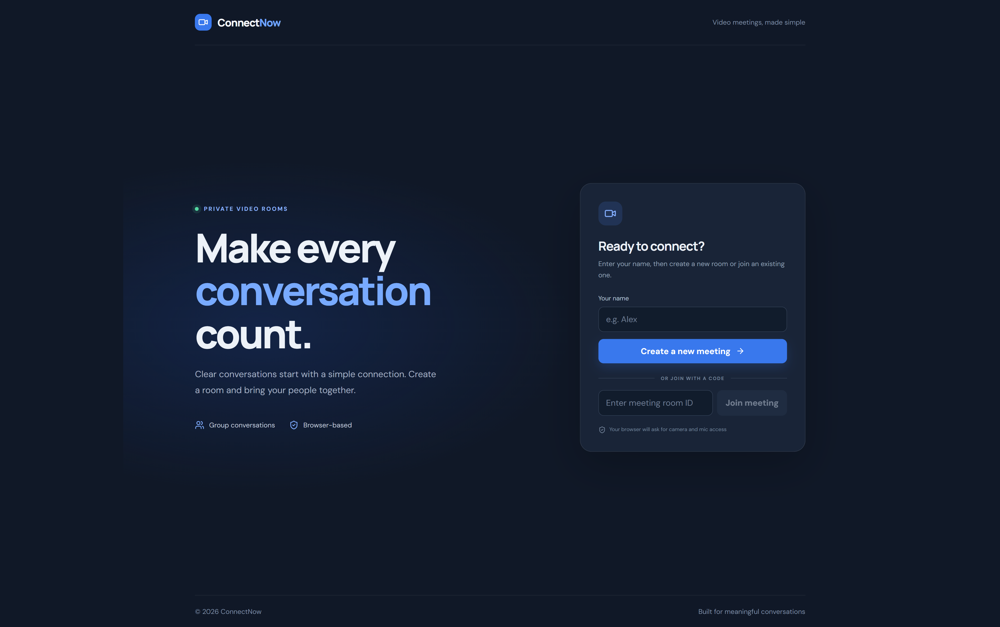
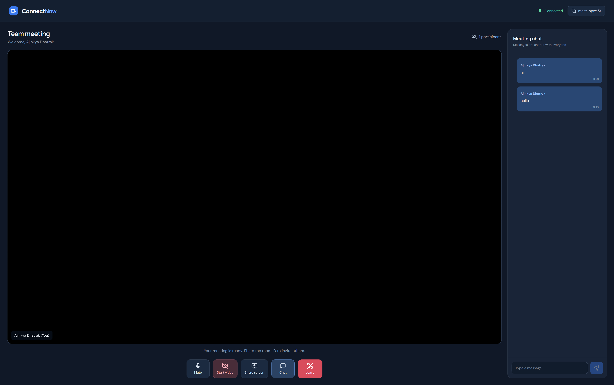

# ConnectNow – Real-Time Video Calling App

<p align="center">
  A real-time video conferencing application built using the MERN stack, WebRTC, and Socket.IO.
</p>

<p align="center">
  
  
  
  
  
  
  
  
</p>

---

## 📌 Overview

**ConnectNow** is a real-time video calling application that allows users to create meeting rooms, invite participants, and communicate through live audio and video.

Built with the MERN stack and WebRTC, the application provides peer-to-peer video communication, real-time messaging, and screen-sharing functionality through a clean and responsive interface.

## 📸 Screenshots

<!-- Replace the image paths below with your actual screenshots -->

### 1. Home Page



### 2. Video Meeting Room



---

## ✨ Features

- **Create Meeting Rooms:** Generate unique meeting rooms instantly.
- **Join Meetings:** Join existing meetings using a room ID.
- **Real-Time Video Calling:** Communicate through WebRTC peer-to-peer connections.
- **Audio Controls:** Mute and unmute your microphone.
- **Camera Controls:** Enable or disable your camera.
- **Screen Sharing:** Share your screen with other participants.
- **Real-Time Chat:** Exchange messages during video meetings.
- **MongoDB Integration:** Persist meeting chat messages.
- **Participant Management:** Display connected participants.
- **Responsive UI:** Clean interface for desktop and mobile devices.

## 🛠️ Technologies Used

### Frontend

- React.js
- Vite
- JavaScript (ES6+)
- CSS3
- Lucide React

### Backend

- Node.js
- Express.js
- Socket.IO

### Database

- MongoDB
- Mongoose

### Real-Time Communication

- WebRTC
- Socket.IO
- STUN Servers

---

## 📂 Project Structure

```text
video-call-app/
│
├── client/
│   ├── public/
│   ├── src/
│   │   ├── components/
│   │   │   ├── ChatPanel.jsx
│   │   │   └── VideoTile.jsx
│   │   │
│   │   ├── config/
│   │   │   └── iceServers.js
│   │   │
│   │   ├── hooks/
│   │   │   └── useCall.js
│   │   │
│   │   ├── pages/
│   │   │   ├── Home.jsx
│   │   │   └── Meeting.jsx
│   │   │
│   │   ├── App.jsx
│   │   ├── main.jsx
│   │   └── styles.css
│   │
│   ├── index.html
│   ├── package.json
│   └── vite.config.js
│
├── server/
│   ├── src/
│   │   ├── models/
│   │   │   └── Message.js
│   │   │
│   │   ├── routes/
│   │   │   └── chatRoutes.js
│   │   │
│   │   ├── socket/
│   │   │   └── callHandlers.js
│   │   │
│   │   └── index.js
│   │
│   ├── .env.example
│   └── package.json
│
├── .gitignore
├── package.json
└── README.md
```

## ⚙️ Installation & Setup

### Prerequisites

Make sure you have installed:

- Node.js (v18 or later)
- npm
- MongoDB (local installation or MongoDB Atlas)
- Git

### 1. Clone the Repository

```bash
git clone https://github.com/YOUR_USERNAME/ConnectNow.git
```

### 2. Navigate to the Project

```bash
cd ConnectNow
```

### 3. Install Dependencies

Install root dependencies:

```bash
npm install
```

Install frontend and backend dependencies:

```bash
npm run install:all
```

### 4. Configure Environment Variables

Create a `.env` file inside the `server` directory.

```env
PORT=5000
CLIENT_URL=http://localhost:5173
MONGODB_URI=mongodb://127.0.0.1:27017/connectnow
```

You can also use your MongoDB Atlas connection string.

### 5. Start the Application

Run both frontend and backend servers:

```bash
npm run dev
```

### 6. Open the Application

Visit:

```text
http://localhost:5173
```

---

## 📞 How to Use

1. Open ConnectNow in your browser.
2. Enter your display name.
3. Click **Create a New Meeting**.
4. Copy the generated meeting room ID.
5. Share the room ID with another participant.
6. The other participant can join using the same room ID.
7. Start communicating through video, audio, and real-time chat.

---

## 🔄 How WebRTC Works

ConnectNow uses WebRTC for peer-to-peer audio and video communication.

1. Users join a meeting room through Socket.IO.
2. The server exchanges participant information.
3. WebRTC creates peer connections between participants.
4. SDP offers and answers are exchanged through Socket.IO.
5. ICE candidates are exchanged to establish connectivity.
6. Audio and video streams are transmitted directly between participants.

---

## 🔐 Environment & Deployment Notes

- HTTPS is required for camera and microphone access outside localhost.
- A TURN server may be required for connectivity across restrictive networks.
- Configure MongoDB Atlas for persistent chat storage.
- The current implementation uses peer-to-peer mesh connections and is intended as a starter for small meetings.
- For larger meetings, consider an SFU solution such as LiveKit or mediasoup.

---

## 🚀 Future Improvements

- User authentication with JWT
- User profiles and account management
- Private and password-protected meetings
- Meeting history
- Schedule meetings
- Participant controls
- Meeting recording
- Virtual backgrounds
- Screen-sharing improvements
- SFU-based group calling

---

## 👨‍💻 Author

**Ajinkya Dhatrak**

GitHub: [ajinkya029](https://github.com/ajinkya029)

---

<p align="center">
  ⭐ If you like this project, consider giving it a star!
</p>
